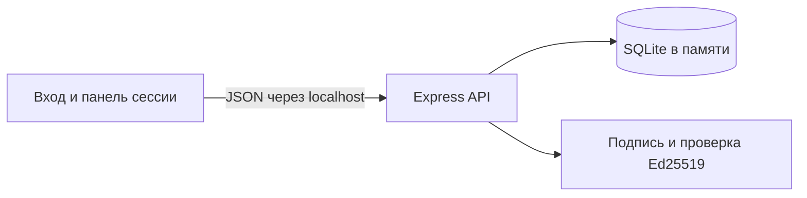

<div align="center">

# Scarlex · Portfolio

**Клиент-серверная архитектура Windows-приложения**


[Возможности](#возможности) · [Архитектура](#архитектура) · [Быстрый старт](#быстрый-старт)

</div>

Scarlex — учебный проект на стыке нативной разработки, веб-интерфейсов и серверного лицензирования. В исходном приложении интерфейс работает в WebView2, а отдельный модуль рендеринга использует Direct3D 11. Этот репозиторий содержит независимо запускаемую демонстрацию и отдельные примеры из графического модуля.

## Возможности

- **Лицензирование.** Express и SQLite проверяют демонстрационный ключ и при активации связывают его с вымышленным идентификатором устройства. Настоящие сведения об оборудовании не считываются.
- **Подписанные сессии.** API выпускает короткоживущий билет Ed25519. При продлении проверяются подпись, срок действия и привязка. Тесты покрывают отклонение чужого устройства и подменённой подписи.
- **Интерфейс.** Экран входа и панель сессии используют оформление исходного клиента и работают в обычном браузере без нативного хоста.
- **Графика.** В `rendering/` — исходный HLSL-шейдер, который выводит цвет с предумноженной альфой, и C++-структуры геометрии с аффинными преобразованиями. Это фрагменты рендера, не готовое Windows-приложение.

## Архитектура



Интерфейс ведёт только состояние экрана. Хеши ключей и привязка к устройству хранятся на сервере. Билет остаётся в памяти вкладки, а ключи подписи создаются заново при каждом запуске. Подписанные обновления были частью исходной архитектуры, но демонстрация не распространяет и не запускает бинарные пакеты.

Подробнее: [устройство демонстрации и сценарии проверки](docs/demo-architecture.md).

## Быстрый старт

Понадобятся Node.js 24+ и npm. Из корня репозитория:

```sh
npm install
npm test
npm start
```

Откройте `http://127.0.0.1:4300` и нажмите «Проверить ключ». Тестовое значение уже подставлено. После входа попробуйте продлить билет. Сервер слушает только локальный интерфейс; при перезапуске данные сбрасываются.

| Путь | Содержимое |
| --- | --- |
| `ui/` | Экран входа, панель сессии и локальные ресурсы |
| `server.mjs` | Express-маршруты и раздача интерфейса |
| `licenses.mjs` | SQLite, активация, подпись и продление билетов |
| `tests/` | Тесты лицензирования и проверки подписи |
| `rendering/` | Фрагменты исходного рендера: C++ и HLSL |
| `docs/` | Описание демонстрации и сценарии проверки |

## О проекте

Учебная демонстрация, не готовая система лицензирования для продакшена. Приведённые команды запускают только локальное демо; оно не обращается к рабочим серверам, базам пользователей или закрытым ключам. Не вводите настоящие лицензионные ключи.
