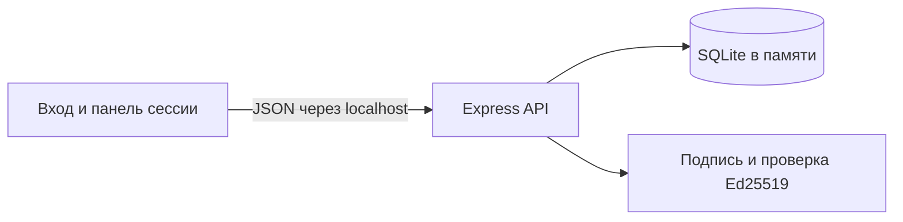
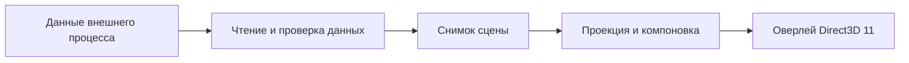

<div align="center">

# Scarlex · Portfolio

**Клиент-серверная архитектура Windows-приложения**


[Возможности](#возможности) · [Архитектура](#архитектура) · [Нативный клиент](#нативный-клиент) · [Быстрый старт](#быстрый-старт)

</div>

Scarlex — учебный проект, в котором нативный клиент на C++20 объединяет внешний источник данных, прозрачный оверлей Direct3D 11 и лаунчер на WebView2. Сервер на Express управляет лицензиями и сессиями. В репозитории можно отдельно запустить демо лицензирования и посмотреть исходные модули; оно не читает память других процессов.

## Возможности

- **Лицензирование.** Express и SQLite проверяют демонстрационный ключ и при активации связывают его с вымышленным идентификатором устройства. Настоящие сведения об оборудовании не считываются.
- **Подписанные сессии.** API выпускает короткоживущий билет Ed25519. При продлении проверяются подпись, срок действия и привязка. Тесты покрывают отклонение чужого устройства и подменённой подписи.
- **Интерфейс.** Экран входа и панель сессии используют оформление исходного клиента и работают в обычном браузере без нативного хоста.
- **Графика.** В `rendering/` — исходный HLSL-шейдер, который выводит цвет с предумноженной альфой, и C++-структуры геометрии с аффинными преобразованиями. Это фрагменты рендера, не готовое Windows-приложение.

## Архитектура



Интерфейс ведёт только состояние экрана. Хеши ключей и привязка к устройству хранятся на сервере. Билет остаётся в памяти вкладки, а ключи подписи создаются заново при каждом запуске. Подписанные обновления были частью исходной архитектуры, но демонстрация не распространяет и не запускает бинарные пакеты.

Подробнее: [устройство демонстрации и сценарии проверки](docs/demo-architecture.md).

## Нативный клиент

В полном клиенте чтение памяти и отрисовка — отдельные этапы. Оверлей работает со снимком сцены, а не обращается к источнику данных для каждой подписи или фигуры.



- **Из чтения памяти — в модель сцены.** Слой чтения преобразует сырые данные в структуры C++: состояние камеры, позиции и позы объектов. Он проверяет результаты чтения и отделяет доступные данные от неполных или устаревших. Так ошибка в источнике не превращается в ошибку рендеринга.
- **Два потока и два буфера.** Поток чтения подготавливает следующий снимок, а поток рендеринга использует уже опубликованный. У чтения и отрисовки разные темпы; время чтения и возраст снимка измеряются отдельно. Это позволяет различить задержку данных и задержку отрисовки.
- **Прозрачный оверлей.** Координаты из сцены проецируются в экранные, а рендерер рисует линии, подписи, иконки, мини-карту и сетки. Для композиции используется DXGI с предумноженной альфой. Положение и видимость подписей и иконок можно настроить в редакторе с предпросмотром и привязкой к позициям.
- **3D-геометрия.** Модуль рендеринга отделяет геометрию от текущей позы. Для анимированных сеток вершины преобразуются по матрицам костей и весам, а треугольники передаются в Direct3D 11 через индексный буфер. Примеры аффинных преобразований и HLSL-шейдера лежат в [`rendering/`](rendering/).
- **Лаунчер и диагностика.** WebView2 передаёт события интерфейса в C++ через JSON. В полном клиенте отдельно проверяются подпись сессионного билета и целостность обновления; ошибки помечаются этапом запуска, чтобы отличить сбой авторизации, обновления и инициализации клиента.

Этот раздел описывает работу над полным клиентом. Команды ниже запускают только браузерный интерфейс и локальное API на тестовых данных.

## Быстрый старт

Понадобятся Node.js 24+ и npm. Из корня репозитория:

```sh
npm install
npm test
npm start
```

Откройте `http://127.0.0.1:4300` и нажмите «Проверить ключ». Тестовое значение уже подставлено. После входа попробуйте продлить билет. Сервер слушает только локальный интерфейс; при перезапуске данные сбрасываются.

| Путь | Содержимое |
| --- | --- |
| `ui/` | Экран входа, панель сессии и локальные ресурсы |
| `server.mjs` | Express-маршруты и раздача интерфейса |
| `licenses.mjs` | SQLite, активация, подпись и продление билетов |
| `tests/` | Тесты лицензирования и проверки подписи |
| `rendering/` | Фрагменты исходного рендера: C++ и HLSL |
| `docs/` | Описание демонстрации и сценарии проверки |

### Исходные модули

В дополнение к демо здесь собраны отдельные модули исходного проекта. Они не требуются для `npm start` и не составляют полную сборку клиента или сервера.

| Путь | Содержимое |
| --- | --- |
| `assets/` | Исходный логотип, шрифт Inter и его лицензия |
| `deploy/scarlex-vps/` | Схема SQLite, миграции, хранилище лицензий и функции сравнения версий |
| `licensing/` | Разбор и сравнение версий на C++ |
| `loader/` | Утилита извлечения публичного ключа Ed25519 из PEM |
| `third_party/monocypher/` | Криптографическая библиотека и её лицензия |

## О проекте

Учебная демонстрация, не готовая система лицензирования для продакшена. Приведённые команды запускают только локальное демо; оно не обращается к рабочим серверам, базам пользователей или закрытым ключам. Не вводите настоящие лицензионные ключи.
